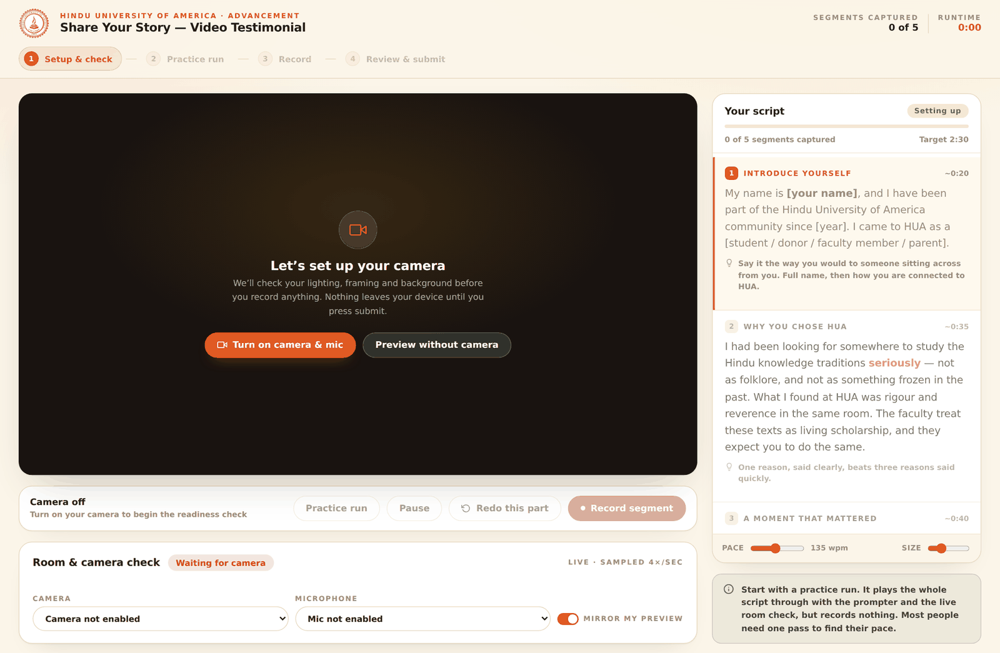
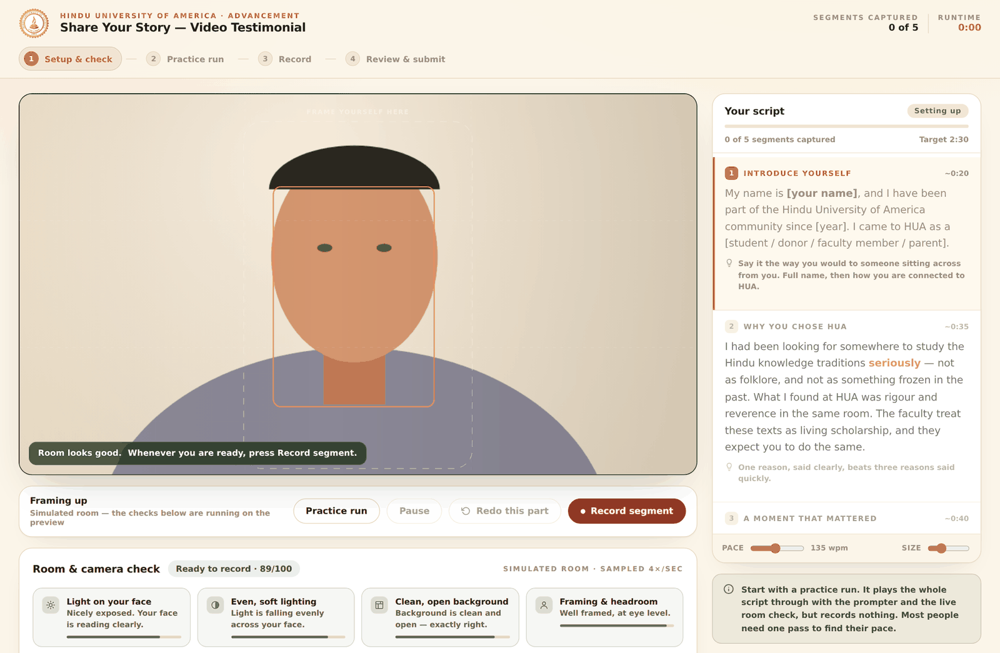
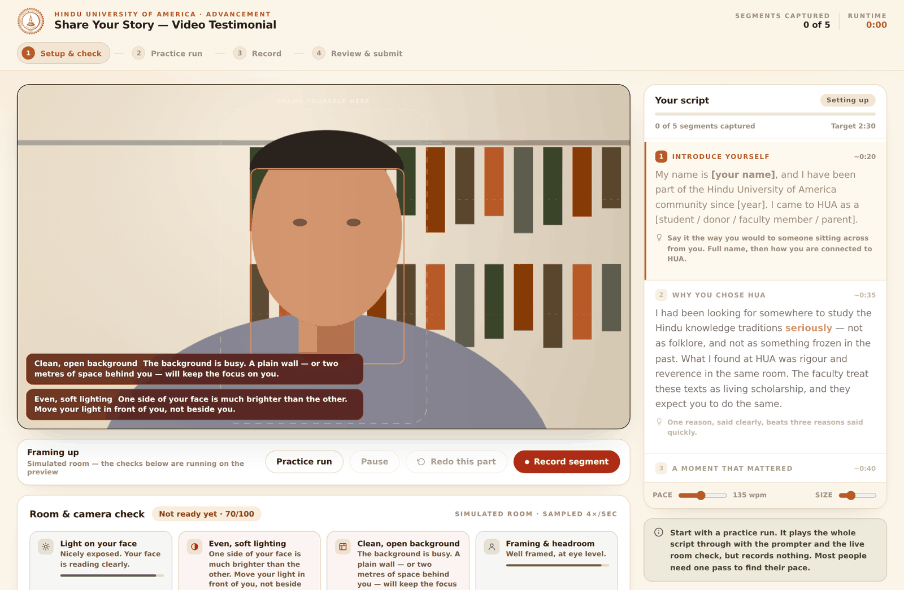
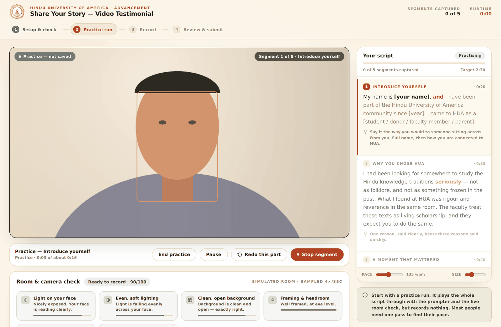
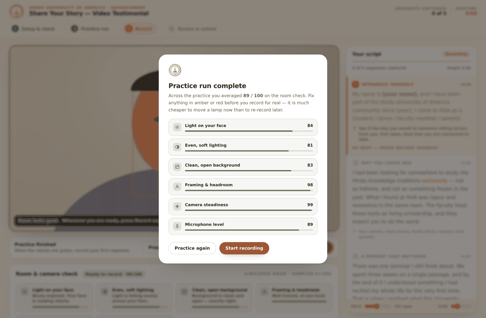
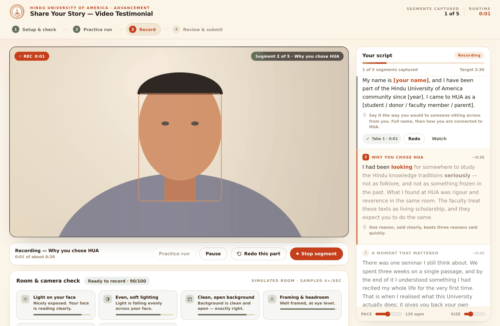
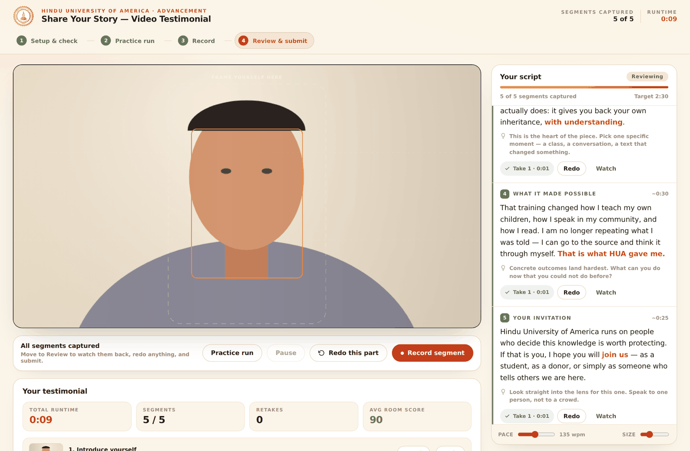
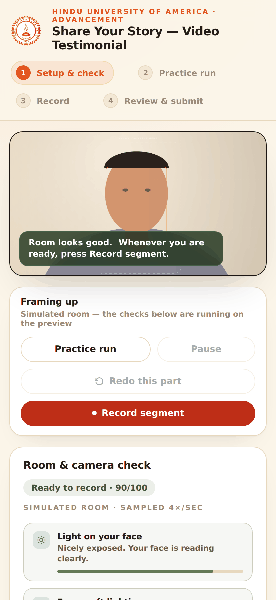

# Share Your Story — video testimonial page

A guided, browser-only testimonial recorder for Hindu University of America.
The reader gets a teleprompter on the right, a live camera stage on the left,
and a room check that tells them what to fix *before* they record rather than
after.

**Implementation:** [`video-testimonial.html`](https://github.com/khushald-arch/hua/blob/main/video-testimonial.html)
in the `hua` repo — one self-contained file, no build step and no dependencies,
sitting alongside `index.html` and `student-giving.html`.

---

## The flow

`Setup & check → Practice run → Record → Review & submit`

Each stage is reachable from the stepper once the camera is on, so nobody is
trapped in a wizard.

| Stage | What happens |
| --- | --- |
| **Setup & check** | Camera and mic go on, six live checks run four times a second, coaching notes appear over the video. |
| **Practice run** | The whole script plays through the prompter with the room check live. Nothing is recorded. Ends with a per-check report card. |
| **Record** | One segment at a time. Pause and resume mid-take; redo any segment on its own without touching the others. |
| **Review & submit** | Watch each take back, redo what you don't like, then submit or download. |

## Recording in segments, not one long take

The script is five segments. Each is recorded as its own clip, so a fluffed
line in segment 3 costs you segment 3 — not the whole piece. Every segment
carries a take counter, its duration, and the average room score measured
while it was rolling.

- **Pause / Resume** pauses `MediaRecorder` and the prompter together.
- **Redo this part** discards that segment's take and rewinds the prompter to
  the top of it. Nothing else is affected.
- A segment auto-stops one second after the prompter runs out of words.

## The room check

Every reading is measured off the live frame, on a 160×90 downscaled copy,
four times a second. No model, no network call.

| Check | Measured from | Passes at |
| --- | --- | --- |
| **Light on your face** | Mean luma **inside the detected face box** (not the whole frame — a bright wall must not mask an under-lit subject), plus clipped-highlight share | ≥ 58 |
| **Even, soft lighting** | Left/right half luma difference, normalised against frame mean — catches side-light and window backlight | ≥ 50 |
| **Clean, open background** | Gradient energy and luma spread over the border ring outside the subject column — clutter raises both | ≥ 55 |
| **Framing & headroom** | Face box width, horizontal centre, and headroom against the frame | ≥ 58 |
| **Camera steadiness** | Frame-to-frame luma difference with global exposure drift removed, so a light flicker doesn't read as shake | ≥ 50 |
| **Microphone level** | RMS in dBFS off a WebAudio `AnalyserNode`, targeting −21 dBFS | ≥ 45 |

**Face detection** uses the browser's `FaceDetector` where it exists. Where it
doesn't, a skin-tone mask falls back to the *dominant* blob: it grows outward
from the busiest column until the count falls away, then does the same for rows
inside that band. Taking the extent of every skin-tone match instead would let
warm wood, brick or a cluttered shelf drag the box across the frame — the
version that did exactly that reported "you are very close to the lens" at a
correctly-seated subject.

A failed check never blocks recording. It warns, names what is amber or red,
and lets the reader decide.

## Preview mode

"Preview without camera" draws a synthetic room to a canvas, publishes it with
`captureStream()`, and adds a low noise floor for the mic. The real analysis
pipeline then runs against it, so the whole page — checks, prompter, recording,
review — is demonstrable without granting camera permission. The
**Simulate a cluttered wall** toggle drives the background check from 86 to 15
so the detector can be seen reacting.

## Privacy posture

Everything stays in the browser. Takes are `Blob`s in memory; nothing is
transmitted until **Submit testimonial**, and `UPLOAD_ENDPOINT` at the top of
the file is `null` until someone points it at a real intake service. Leaving
the page with unsubmitted takes prompts a confirmation.

## Theme

Tokens lifted from the existing HUA pages so this sits next to them unchanged:

```
--hua-cream #FBF5E9   --hua-cream-2 #F4E8D3   --hua-surface #FFFFFF
--hua-ink   #241C17   --hua-ink-2   #6E5D4F   --hua-ink-3   #9C8B79
--hua-orange #E4571E  --hua-gold    #F2A81D   --hua-red     #BE2E17
--hua-sage  #5F7C4C   --hua-line    #E7D8BE   --hua-line-2  #F0E5D2
```

Figtree throughout, 20px cards on a 1px `--hua-line` border, pill buttons,
and the University seal in the header. Sage carries "good", gold "adjust",
red "fix this" — the same three-state language the checks and the stepper use.

## Screens

| | |
| --- | --- |
|  |  |
| **Start** — nothing switches on until asked | **Room check passing** — ready to record, 89/100 |
|  |  |
| **Cluttered background** — check drops, coaching appears | **Practice run** — prompter live, nothing saved |
|  |  |
| **Practice report** — average per check across the run | **Recording** — segment 1 captured, segment 2 rolling |
|  |  |
| **Review** — runtime, retakes, per-segment redo | **Mobile** — single column |

## Known limits

- Segments are separate WebM clips; joining them into one file is a server-side
  job, not something to attempt in the browser.
- The skin-tone fallback is a heuristic. It is good enough to coach framing,
  and it is not identity detection — Safari, which has no `FaceDetector`,
  relies on it entirely.
- `MediaRecorder` output is WebM on Chrome, Edge and Firefox. Safari's support
  varies by version; the page says so plainly rather than failing silently.
